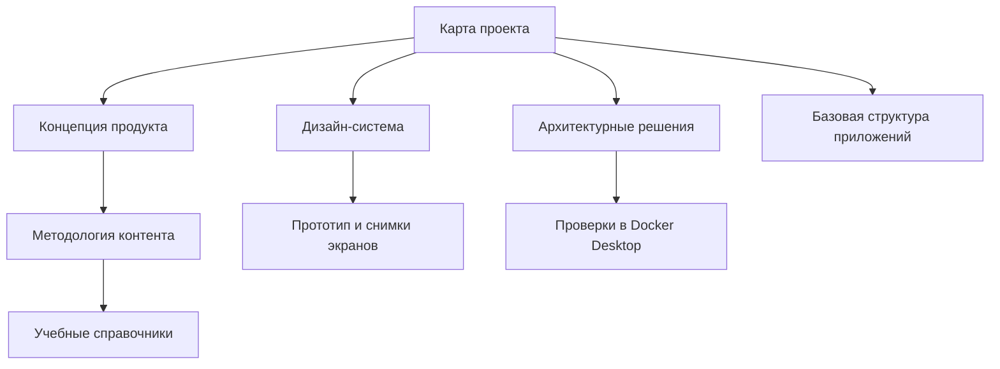

# Карта проекта

Начните с задачи в таблице. Откройте целевой документ и переходите по связанным ссылкам, когда затронута соответствующая область.

| Задача | Начать с | Связанные материалы |
| --- | --- | --- |
| Аудитория, форматы, путь от брифа до публикации | [Концепция продукта](../product.md) | [Методология контента](../methodology.md) → [пересказ и примеры](../references/storytelling-method-and-examples.md), [учебная таблица](../references/storytelling-workbook-content.md) |
| Типографика, палитра, адаптивность и состояния | [Дизайн-система](../design-system.md) | [Прототип и снимки экранов](../design/proposal-01/README.md) |
| Техническое решение или проверка готовности модуля | [Архитектурные решения](../architecture.md) | [Проверки в Docker Desktop](../local-development.md) |
| Запуск, зависимости и точки входа приложений | [Базовая структура приложений](foundation.md) | [Архитектурные решения](../architecture.md) |

Когда в v2 появится модуль, добавьте его в диаграмму и таблицу. Ссылка узла должна вести к описанию модуля с контрактом, фактическими точками входа, зависимостями и проверками. При изменении связей обновите диаграмму и ссылки вместе с изменением модуля.
